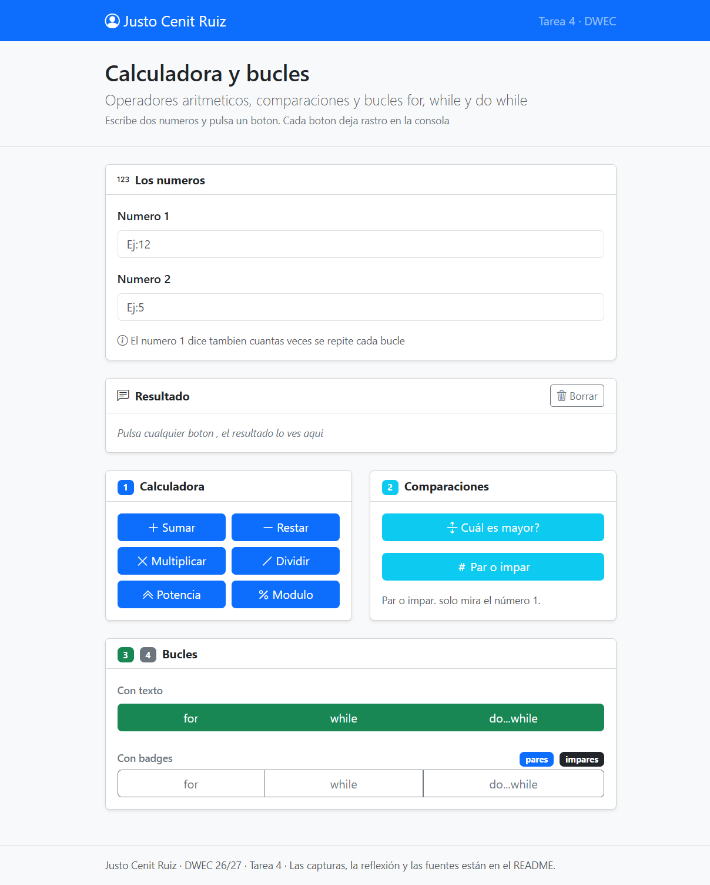
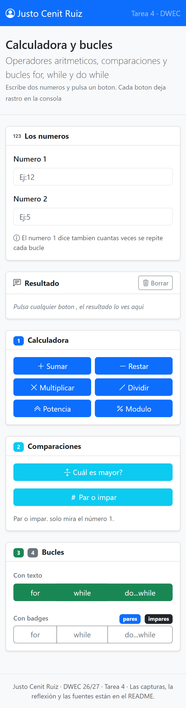
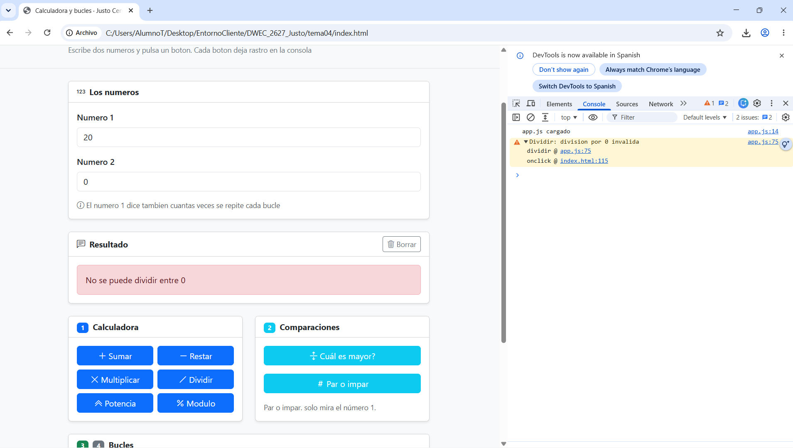
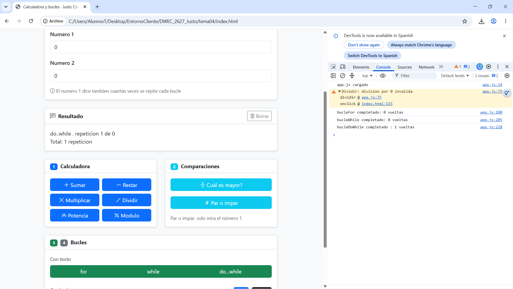
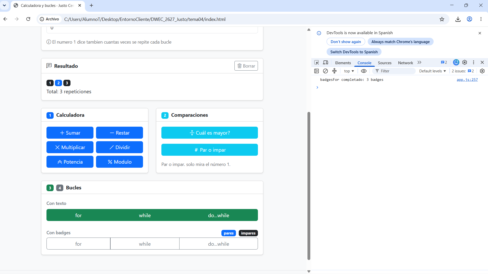

# Tarea 4 · Calculadora y bucles

**Autor:** Justo Cenit Ruiz · Desarrollo Web en Entorno Cliente (DWEC) · 2.º DAW · Curso 2026-27

En esta carpeta está la práctica del tema 4 sobre operadores aritméticos, comparaciones y bucles en JavaScript. Para probarla, abre la carpeta en VS Code, inicia **Live Server** (Go Live), escribe los números en las casillas y pulsa los botones con la consola abierta (F12) para ver los resultados y los registros.

## Capturas

### a) La página entera

Se ve la interfaz completa en pantalla grande con mi nombre en la navbar y las cards organizadas en columnas con la rejilla de Bootstrap.

### b) La página en el móvil

Al activar la vista móvil en F12, las cards dejan las columnas y se colocan una debajo de otra en una sola columna vertical (`col-12`).

### c) El error de dividir entre 0

Al intentar dividir entre 0, el código lo intercepta con un `if`, saca el aviso en rojo en la web y deja la advertencia en la consola con `console.warn()`, evitando que JavaScript devuelva `Infinity`.

### d) Los tres bucles con el número 0

Al poner 0 en la casilla, `for` y `while` comprueban la condición antes de entrar y dan 0 repeticiones. En cambio, `do...while` entra primero al bloque y hace obligatoriamente 1 vuelta antes de evaluar la condición.

### e) Un bucle con badges

Al pulsar el bucle con badges, se muestran las repeticiones alternando colores con un operador ternario: azul (`primary`) para pares y oscuro (`dark`) para impares, junto a la línea del total al final.

## Reflexión

Los bucles `for`, `while` y `do...while` sirven para repetir bloques de código, pero se diferencian en el momento exacto en el que evalúan su condición. El `for` se utiliza normalmente cuando sabemos de antemano el número exacto de vueltas gracias a su estructura con contador. El `while` es más adecuado cuando las repeticiones dependen de una condición externa que se comprueba antes de entrar a cada iteración. En cambio, el `do...while` siempre entra y ejecuta el bloque de código al menos una vez antes de comprobar si la condición se cumple. Esto se comprueba con el 0: mientras `for` y `while` dan 0 repeticiones porque no cumplen la condición de entrada, `do...while` ejecuta una primera vuelta y marca 1 repetición.

## Fuentes

- [Bootstrap 5 Documentation](https://getbootstrap.com/docs/5.3/getting-started/introduction/)
- [MDN Web Docs: Bucles e iteración](https://developer.mozilla.org/es/docs/Web/JavaScript/Guide/Loops_and_iteration)
- [MDN Web Docs: Operador condicional (ternario)](https://developer.mozilla.org/es/docs/Web/JavaScript/Reference/Operators/Conditional_operator)

## Uso de IA

Se ha utilizado Gemini para:
- Comprender, revisar y verificar la maquetación de la rejilla de Bootstrap (`row` y `col-*`) para asegurar que las columnas no se rompieran y se adaptaran bien al móvil.
- Entendimiento y resolución de errores que salían en la consola (como fallos sintácticos y nombres mal escritos tipo `ReferenceError`).
- Aclarar el funcionamiento de las funciones de `ayudas.js` y comprobar la sintaxis del operador ternario para alternar los colores de los badges y los textos en singular/plural.
-Revisión de readme(Creación propia de readme) y estructura con md