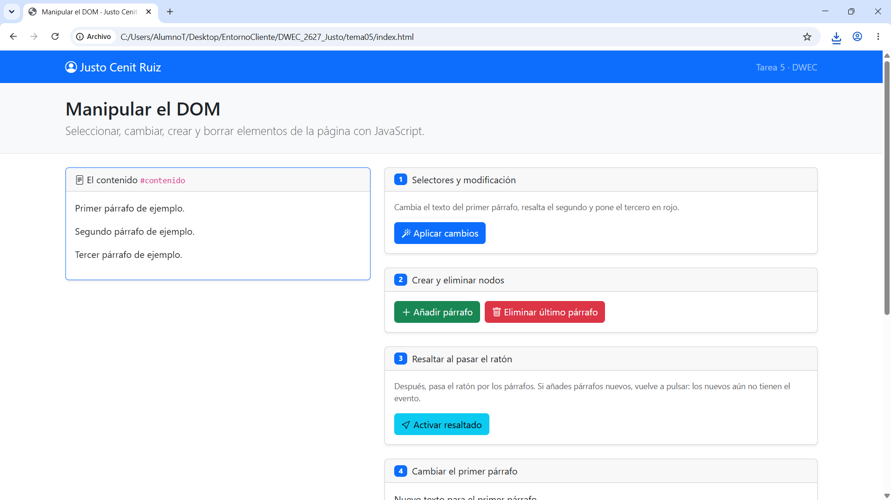
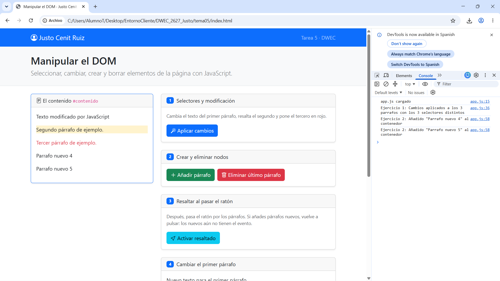
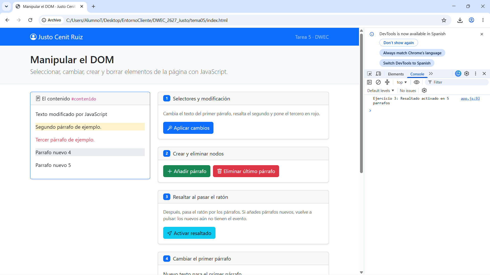
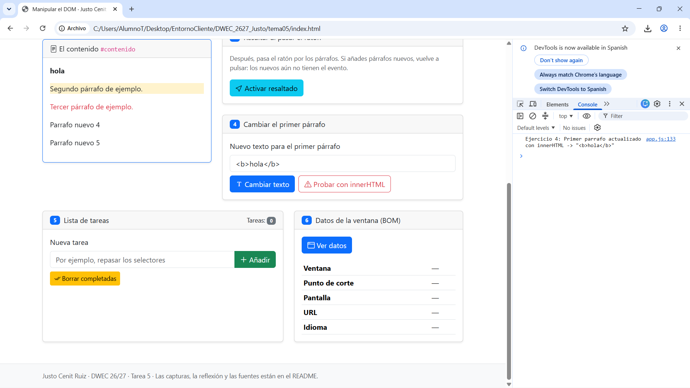
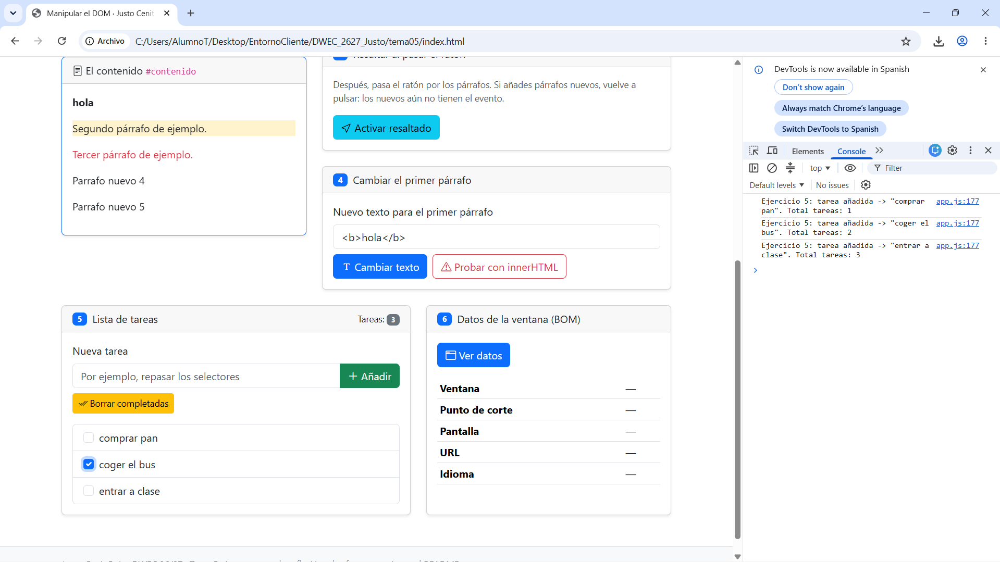
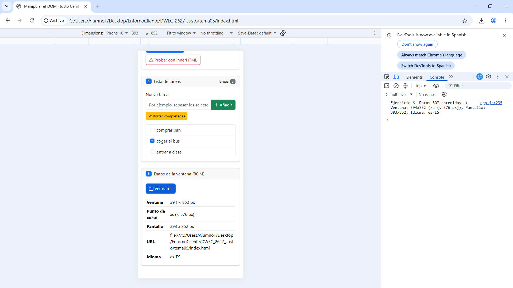

# Tarea 5 · Manipular el DOM

**Autor:** Justo Cenit Ruiz · Desarrollo Web en Entorno Cliente (DWEC) · 2.º DAW · Curso 2026-27

En esta carpeta está la práctica del tema 5 sobre manipulación del DOM y consulta del BOM con JavaScript. Para probarla basta con abrir la carpeta en VS Code, iniciar **Live Server** (Go Live) y probar las diferentes opciones con la consola abierta (F12) para ver los registros y resultados.

## Capturas

### a) La página recién cargada

Se ve la interfaz nada más cargar la página con mi nombre en la navbar, la cabecera y los tres párrafos iniciales que vienen por defecto en `#contenido`.

### b) Ejercicios 1 y 2

Muestra el resultado tras pulsar «Aplicar cambios» (el primer párrafo cambia su texto con `getElementById`, el segundo se resalta con `querySelector` y `.segundo`, y el tercero se pone en rojo con `querySelectorAll` y su posición) y después de añadir dos párrafos nuevos numerados con `createElement` y `append`.

### c) Ejercicio 3: resaltado al pasar el ratón

Al poner el ratón encima de un párrafo se activa la clase `bg-body-secondary` con el evento `mouseenter`, y al sacarlo se quita con `mouseleave`. Si añades párrafos nuevos no se resaltan porque cuando pulsas el botón, `querySelectorAll` solo le pone los eventos a los que ya estaban creados en ese momento.

### d) Ejercicio 4: `<b>hola</b>` con innerHTML

Al pulsar «Cambiar texto», `textContent` escribe `<b>hola</b>` como texto normal y se leen las etiquetas. En cambio, con «Probar con innerHTML», el navegador sí interpreta las etiquetas y muestra la palabra en negrita.

### e) Ejercicio 5: la lista de tareas

Se ve la lista con tres tareas añadidas dinámicamente con su checkbox y texto, una de ellas marcada para borrar y el contador de tareas arriba marcando 3.

### f) Ejercicio 6: los datos de la ventana en el móvil

Al activar la vista móvil en F12, los datos de la ventana cambian con las medidas pequeñas y el punto de corte pasa a ser `xs (< 576 px)`, mientras que en el ordenador marcaba `xl` o `xxl`.

## Reflexión

La diferencia entre `textContent` e `innerHTML` es que `textContent` mete todo como texto plano sin interpretar nada (los caracteres especiales o etiquetas los pinta tal cual en la pantalla), mientras que `innerHTML` analiza lo que le pasas y si lleva etiquetas HTML las renderiza en el documento. Esto se ve con el ejemplo de `<b>hola</b>`: con `textContent` se lee literalmente la etiqueta `<b>` en la página, y con `innerHTML` se convierte en texto en negrita. Por esta razón nunca hay que meter en `innerHTML` lo que escriba un usuario, ya que podría meter etiquetas con código malicioso (ataques XSS o Cross-Site Scripting) y ejecutar scripts en el navegador que comprometan la seguridad de la página o roben datos de la sesión.

## Fuentes

- [MDN Web Docs: Document Object Model (DOM)](https://developer.mozilla.org/es/docs/Web/API/Document_Object_Model)
- [MDN Web Docs: Element.classList](https://developer.mozilla.org/es/docs/Web/API/Element/classList)
- [MDN Web Docs: Node.textContent](https://developer.mozilla.org/es/docs/Web/API/Node/textContent)
- [Bootstrap 5 Breakpoints Documentation](https://getbootstrap.com/docs/5.3/layout/breakpoints/)

## Uso de IA

Se ha utilizado Gemini para:
- Entender el funcionamiento de varios apartados del JavaScript, como el uso de `parentElement.remove()` para borrar nodos padres en listas dinámicas, la selección de casillas marcadas con el pseudo-selector `:checked` y el recorrido de listas con `for...of`.
- Comprender por qué los párrafos creados después de activar `mouseenter` y `mouseleave` no adquirían los eventos automáticamente (asociación estática de eventos en el DOM).
- Detectar y entender errores en la consola (como fallos sintácticos con `DocumentTimeline` o la falta de la almohadilla `#` en selectores de ID con `querySelector`).
- Estructurar la explicación teórica en la reflexión sobre los riesgos de seguridad (ataques XSS) al manipular `innerHTML` frente a `textContent`.