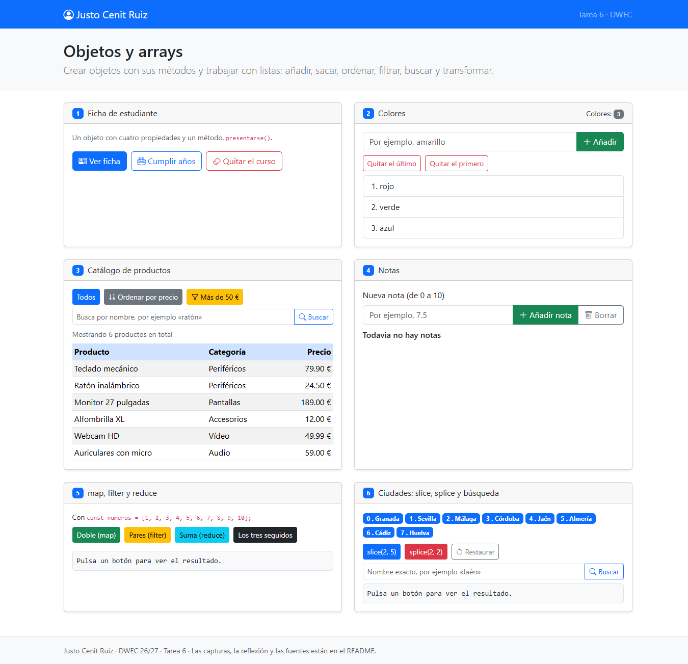
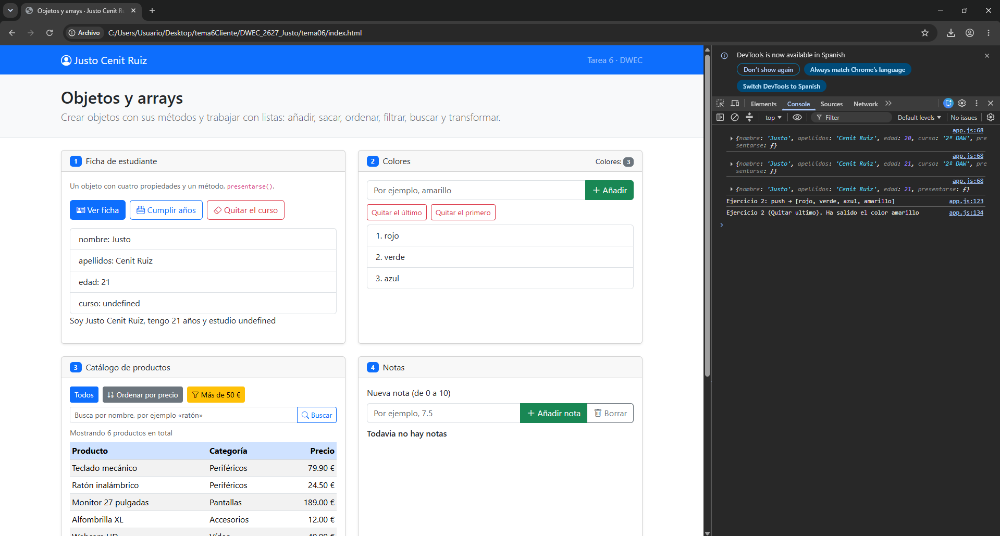
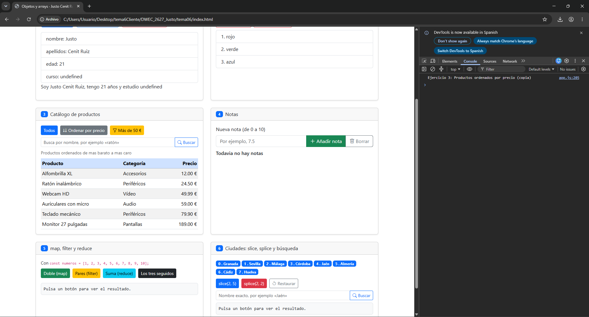
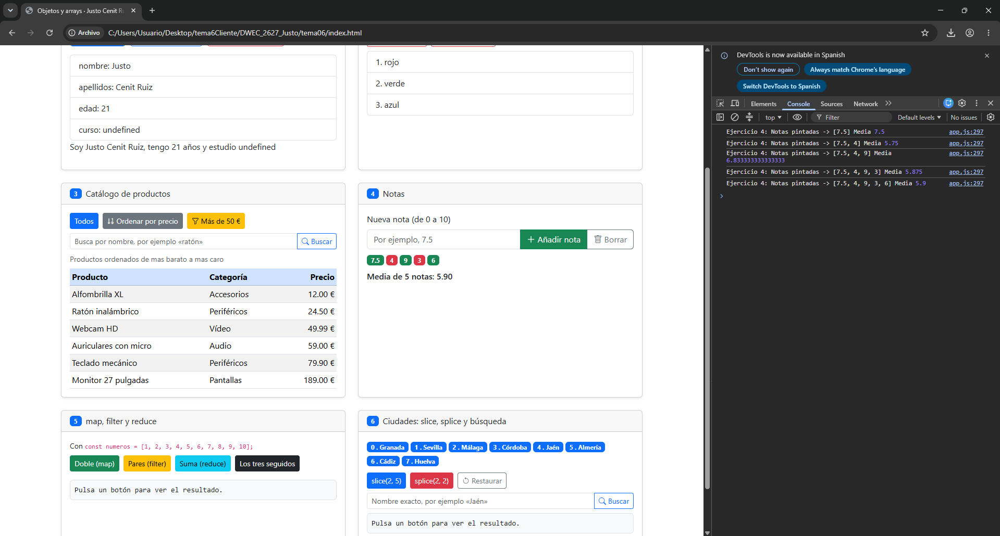
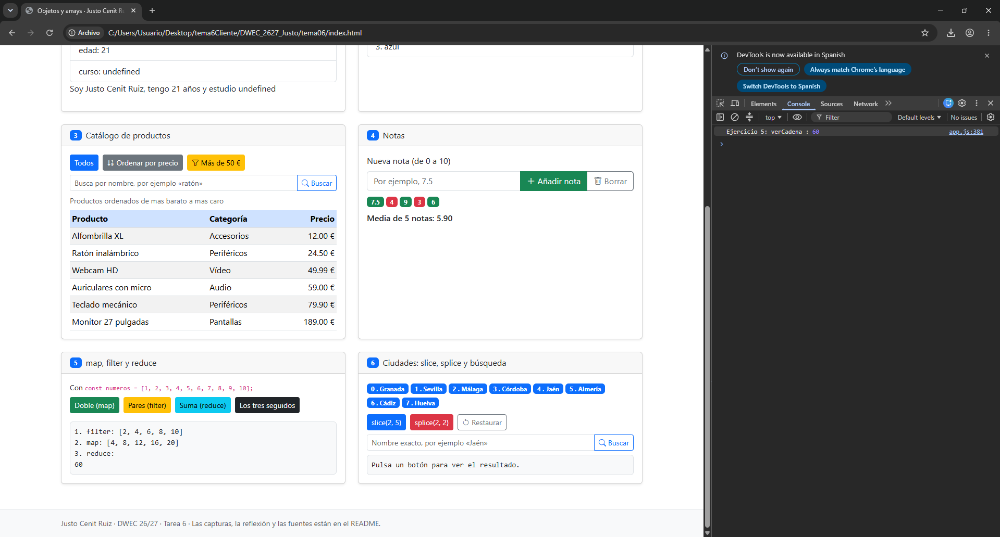
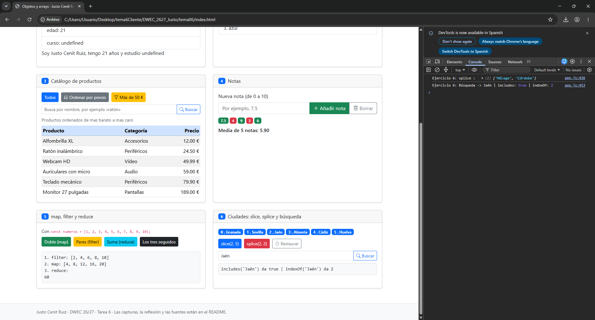

# Tarea 6 · Objetos y arrays

**Autor:** Justo Cenit Ruiz · Desarrollo Web en Entorno Cliente (DWEC) · 2.º DAW · Curso 2026-27

En esta carpeta se encuentra la resolución de la Tarea 6 sobre manejo de objetos y arrays en JavaScript. Para visualizar el proyecto, abre la carpeta en Visual Studio Code, inicia el servidor local con la extensión **Live Server** («Go Live») y abre las herramientas de desarrollador (F12) para comprobar las salidas por consola.

## Capturas

### a) La página recién cargada

En la vista inicial se comprueba la barra de navegación con mi nombre y apellidos, los tres colores base cargados con su contador en 3, el catálogo completo de productos con sus precios originales y la lista inicial de 8 ciudades con sus índices del 0 al 7.

### b) Ejercicios 1 y 2: la ficha y los colores

En la ficha del estudiante se observa la edad actualizada tras usar `cumplirAnios()` y la propiedad `curso` mostrando `undefined` porque fue eliminada del objeto con `delete estudiante.curso`. En la lista de colores se ha añadido uno nuevo con `push()` y se han extraído elementos con `pop()` (último) y `shift()` (primero), actualizándose el contador en cada operación.

### c) Ejercicio 3: el catálogo ordenado por precio

La función de comparación empleada es `function(a, b) { return a.precio - b.precio; }`, que resta los valores numéricos para ordenarlos de menor a mayor. Se ordena una copia generada con el operador spread (`[...productos]`) para evitar mutar el array original y mantener el orden del catálogo intacto en memoria.

### d) Ejercicio 4: las notas y la media

Se muestran cinco notas introducidas y validadas con sus badges correspondientes: verde (`text-bg-success`) para las notas mayores o iguales a 5 y rojo (`text-bg-danger`) para las menores de 5. Debajo se calcula la media aritmética formateada a dos decimales con `toFixed(2)`, obtenida mediante `reduce()`.

### e) Ejercicio 5: los tres métodos seguidos

En primer lugar, `filter()` selecciona únicamente los números pares del array original (`[2, 4, 6, 8, 10]`). A continuación, `map()` multiplica cada uno de ellos por dos (`[4, 8, 12, 16, 20]`). Finalmente, `reduce()` acumula y suma todos los valores resultantes, dando como resultado final el número 60.

### f) Ejercicio 6: después de splice y de buscar una ciudad

El método `splice(2, 2)` ha extraído dos elementos a partir del índice 2, eliminando «Málaga» y «Córdoba». Al buscar posteriormente la ciudad «Jaén», su posición pasa del índice original 4 al índice 2, ya que `splice` modifica directamente el array original y reindexa los elementos restantes.

## Reflexión

Los métodos de arrays en JavaScript se dividen en mutables (que modifican la estructura original en memoria) e inmutables (que devuelven una copia o un nuevo valor sin alterar el origen). Entre los mutables encontramos `push()`, `pop()`, `shift()`, `sort()` y `splice()`. Por ejemplo, en el ejercicio 6, mientras que `slice(2, 5)` extrae una porción y devuelve un array nuevo dejando intactas las 8 ciudades, `splice(2, 2)` recorta y elimina físicamente los elementos del array `ciudades`, alterando su longitud y desplazando las posiciones de los elementos posteriores. Por esta misma razón, en el ejercicio 3 es fundamental ordenar sobre una copia (`[...productos]`) usando el operador spread; si aplicáramos `sort()` directamente sobre el array `productos`, modificaríamos el orden original de la lista permanentemente. Por último, métodos funcionales como `map()` y `filter()` devuelven colecciones nuevas, preservando siempre la integridad de los datos de partida.

## Fuentes

- [MDN Web Docs - Array](https://developer.mozilla.org/es/docs/Web/JavaScript/Reference/Global_Objects/Array)
- [MDN Web Docs - Array.prototype.sort()](https://developer.mozilla.org/es/docs/Web/JavaScript/Reference/Global_Objects/Array/sort)
- [MDN Web Docs - Operador delete](https://developer.mozilla.org/es/docs/Web/JavaScript/Reference/Operators/delete)
- [Bootstrap 5.3 Documentation](https://getbootstrap.com/docs/5.3/getting-started/introduction/)

## Uso de IA

Se ha utilizado gemini como soporte para estructurar la implementación progresiva de los ejercicios en JavaScript, asegurando el cumplimiento de las restricciones técnicas de la tarea (ausencia de funciones flecha, uso de métodos tradicionales y comparaciones estrictas), así como para resolver dudas sobre el cálculo encadenado de `filter`, `map` y `reduce` y revisar la redacción del documento.