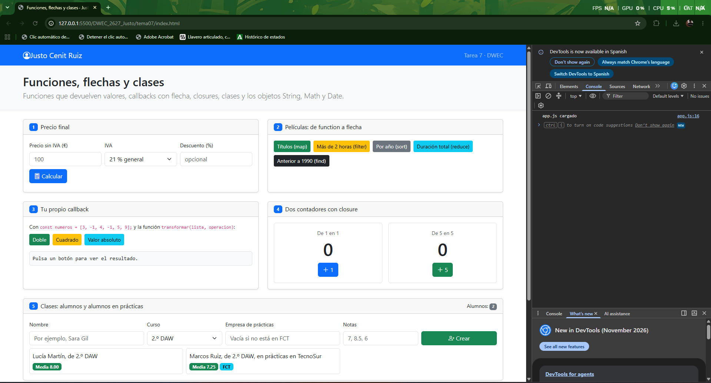
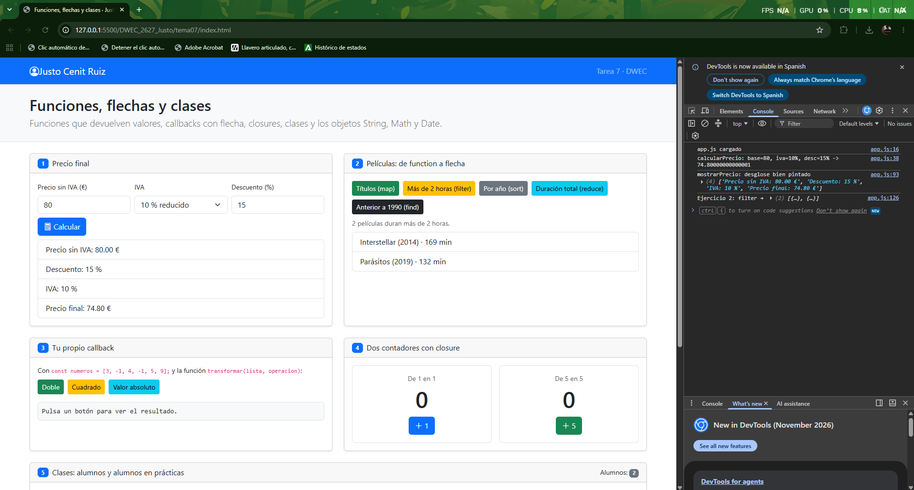
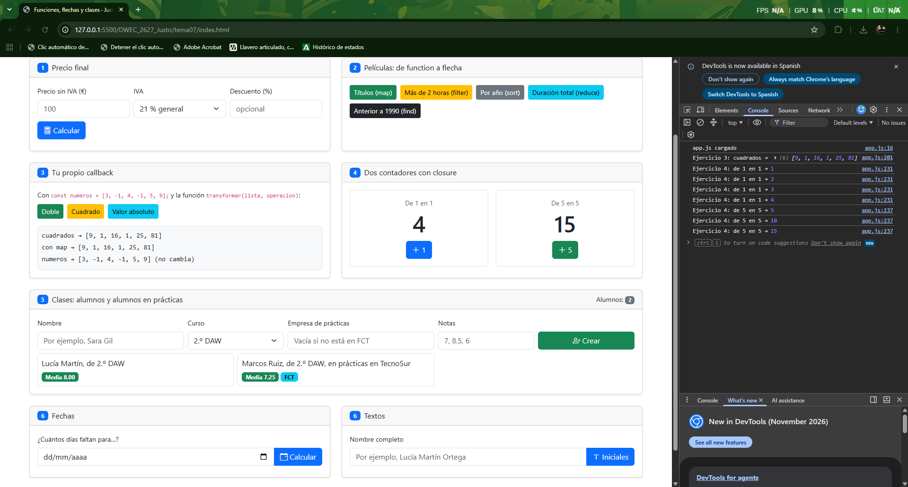
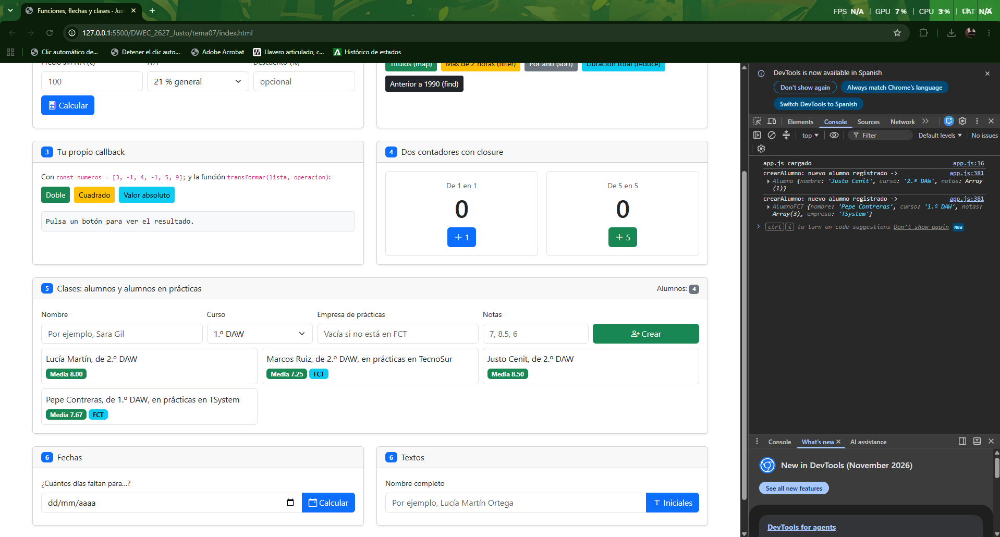
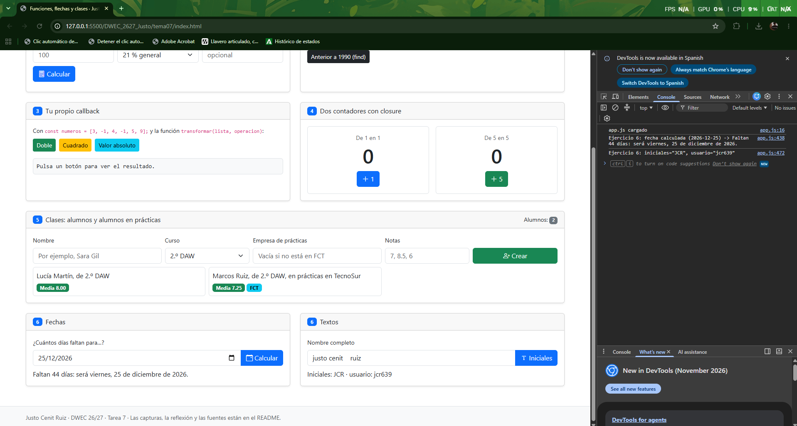

# Tarea 7 · Funciones, flechas y clases

**Autor:** Justo Cenit Ruiz · Desarrollo Web en Entorno Cliente (DWEC) · 2.º DAW · Curso 2026-27

En esta carpeta está la práctica del tema 7 sobre funciones que devuelven valores, callbacks con flecha, closures, clases en JavaScript y manejo de objetos como String, Math y Date. Para probarla basta con abrir la carpeta en VS Code, iniciar Live Server (Go Live) y probar los botones con la consola abierta (F12) para comprobar los registros y resultados.

## Capturas

### a) La página recién cargada

Se ve la interfaz nada más cargar la página con mi nombre en la barra de navegación, el encabezado y las dos tarjetas iniciales de los alumnos de partida cargados desde el array.

### b) Ejercicios 1 y 2: el precio y las películas

En el ejercicio 1 se ve el desglose del precio tras calcular una base con descuento e IVA mediante `calcularPrecio()`, mientras que en el ejercicio 2 se muestra el resultado de ordenar las películas por año usando `.sort()` con una función flecha.

### c) Ejercicios 3 y 4: tu callback y los contadores

En el ejercicio 3 se comprueba que `transformar()` da exactamente el mismo resultado que `.map()` recorriendo el array con un bucle `for...of` sin modificar el original. En el ejercicio 4 se observa cómo cada contador avanza por separado gracias a su propio closure.

### d) Ejercicio 5: los alumnos

Se muestran cuatro alumnos con sus notas medias calculadas. El código comprueba si el campo empresa está relleno: si tiene texto crea una instancia de `AlumnoFCT` (mostrando el badge de FCT) y si está vacío crea un `Alumno` normal.

### e) Ejercicio 6: fechas y textos

Al calcular los días hasta el 25/12/2026 se obtiene la diferencia redondeando con `Math.round` para absorber desfases por cambios de hora. Al lado se generan las iniciales limpiando espacios dobles y el nombre de usuario con tres cifras aleatorias usando `padStart`.

## Reflexión

Al pasar un callback de `function` tradicional a función flecha (`=>`) el código queda más limpio y compacto, eliminando la necesidad de escribir la palabra `function`. Cuando el callback solo tiene una expresión en su cuerpo no hacen falta las llaves `{}` ni la sentencia `return`, ya que la flecha realiza un retorno implícito automático. Por ejemplo, en mi código del ejercicio 2 pasé de escribir:
`peliculas.map(function(p) { return p.titulo; })` a una sola línea: `peliculas.map((p) => p.titulo)`. En cambio, si la función flecha necesita ejecutar varias sentencias entre llaves, el `return` vuelve a ser obligatorio. Por último, dentro de una clase no se debe usar una flecha para definir un método porque las funciones flecha no tienen su propio `this` (lo heredan del ámbito léxico donde se crean) y no se añaden al `prototype` de la clase, lo que rompería la herencia con `super` y el comportamiento normal de los objetos.

## Fuentes

- [MDN Web Docs: Funciones flecha](https://developer.mozilla.org/es/docs/Web/JavaScript/Reference/Functions/Arrow_functions)
- [MDN Web Docs: Closures](https://developer.mozilla.org/es/docs/Web/JavaScript/Closures)
- [MDN Web Docs: Clases](https://developer.mozilla.org/es/docs/Web/JavaScript/Reference/Classes)
- [MDN Web Docs: Objeto Date](https://developer.mozilla.org/es/docs/Web/JavaScript/Reference/Global_Objects/Date)

## Uso de IA

Se ha utilizado Gemini para:
- Revisar y verificar la sintaxis de las funciones flecha en callbacks de arrays (`map`, `filter`, `sort`, `reduce`, `find`, `some`) asegurando que los cuerpos de una sola expresión no llevasen llaves ni return.
- Entender el funcionamiento y encapsulación de variables en el ejercicio de closures y por qué `cuenta` no es accesible desde la consola.
- Repasar la herencia de clases en JavaScript moderno con `extends` y la llamada a `super()` tanto en el constructor como en los métodos heredados.
- Estructurar la explicación técnica de la reflexión sobre el contexto léxico de `this` en funciones flecha y métodos de clase.